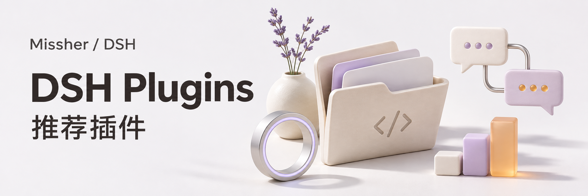
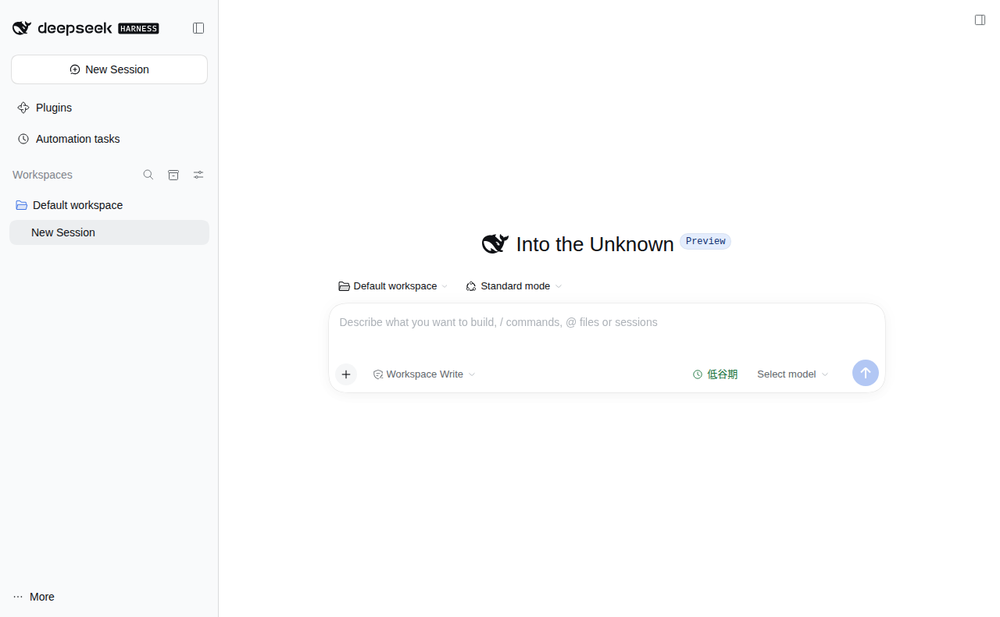
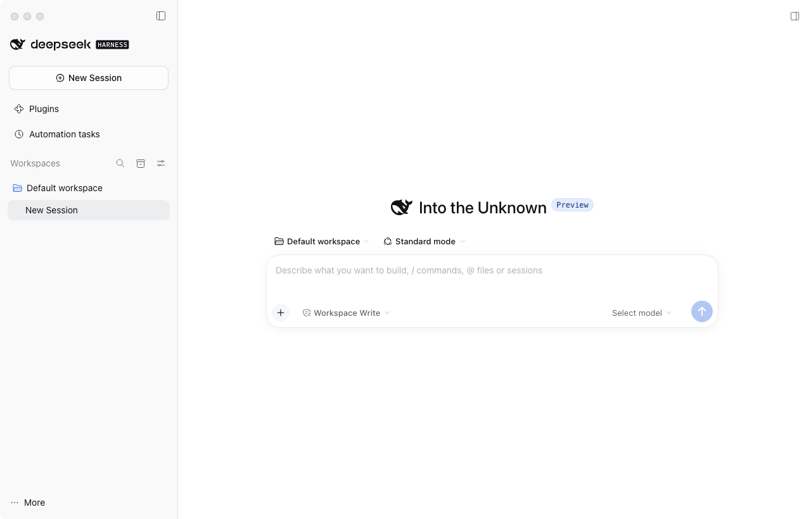

<div align="center">

<h1>Missher DeepSeek Harness · 社区桌面端</h1>

<p></p>

<p>在一个桌面工作区里使用模型、文件、工具与可选插件。</p>

<p>
  <a href="https://github.com/Missher12/Missher-DeepseekHarness-Desktop/releases/tag/desktop-v0.2.1-rc.5.20261030.1"></a>
  <a href="https://github.com/Missher12/Missher-DeepseekHarness-Desktop"></a>
  <a href="https://github.com/Missher12/Missher-DeepseekHarness-Desktop/blob/main/LICENSE"></a>
</p>

<p><a href="#功能一览">功能一览</a> · <a href="#快速开始">快速开始</a> · <a href="#使用场景">使用场景</a> · <a href="#常见问题">常见问题</a> · <a href="#详细文档">详细文档</a> · <a href="../README.md">English</a></p>

</div>

---

## 推荐插件，一次装齐

共 **13 个独立插件**，其中 **12 个公开插件可在一个 Agent 会话中安装**。私有的 Media@Missher Ego 单独处理，记忆系统使用 Memory Native。

```text
读取本仓库 plugins/install-set.json，将其中全部 12 个公开插件安装或更新到我当前使用的 DSH。
使用清单中的 Release 安装包，保留原插件实例、配置和数据；已安装同版或更新版的保留。
优先使用宿主原生插件管理接口，核对宿主兼容性，逐项报告实际安装版本与加载状态。
排除私有的 Media@Missher Ego；缺少能力、失败和待重启的项目单独说明。
```

[查看 12 个推荐插件与完整安装指令](../plugins/README.zh.md#install-recommended-plugins) · [公开安装清单](../plugins/install-set.json)

## 功能一览

| 能做什么 | 说明 |
| --- | --- |
| **桌面工作区** | 组织对话、项目文件、会话与日常 AI 开发工作。 |
| **模型与工具** | 通过宿主配置自己的模型供应商和工具能力。 |
| **独立插件** | 按需安装记忆、上下文、使用统计与其他扩展。 |
| **平台下载** | 从实际 Release 资产中选择与系统、架构匹配的安装包。 |

<a id="downloads"></a>

<!-- existing-screenshots -->
## 界面示例

<table><tr><td><a href="../docs/images/desktop/desktop-ubuntu-alpha2.png"></a></td><td><a href="../docs/images/desktop/desktop-intel-mac-alpha2.png"></a></td></tr></table>

<sub>来自项目已有文档；截图版本与验证范围见<a href="../README.md">原始说明</a>，点击可放大。</sub>
<!-- /existing-screenshots -->

## 快速开始

1. 从 [Releases](https://github.com/Missher12/Missher-DeepseekHarness-Desktop/releases) 选择适合系统与架构的桌面安装包。
2. 按对应平台说明安装并首次启动，配置自己的模型供应商。
3. 需要功能扩展时，查看[独立插件目录](../plugins/README.zh.md)，在应用内插件管理器安装。

## 使用前了解

- 这是 Missher 社区构建，非 DeepSeek 官方发行版；应用不附带模型账户或 API 额度。
- 各版本实际提供的平台、签名与验证范围，以该 Release 的资产和说明为准。

## 插件怎么选

| 需要的能力 | 独立项目与说明 |
| --- | --- |
| 当前上下文容量与长会话整理 | [Context Manager](https://github.com/Missher12/Missher-DSH-Context-Manager) |
| 长期 Token 活动、模型与工具排行 | [使用统计](https://github.com/Missher12/Missher-DSH-Usage-Statistics) |
| 会话 ID、跨会话引用与 scratch | [Session Bridge](https://github.com/Missher12/Missher-DSH-Session-Bridge) |
| 独立任务派发、进度与结果回传 | [Superagent](https://github.com/Missher12/Missher-DSH-Superagent) |
| 回答排版、思考折叠与搜索来源 | [输出外观](https://github.com/Missher12/Missher-DSH-Output-Renderer) |
| 模型已声明的思考档位与配置指引 | [推理强度](https://github.com/Missher12/Missher-DSH-Reasoning-Effort) |
| 会话文件、预览、项目方案与搜索历史 | [Project Ops](https://github.com/Missher12/Missher-DSH-Project-Ops) |
| 任务方法、原生清单与执行提醒 | [Focus](https://github.com/Missher12/Missher-DSH-Focus) |
| 长期事实、偏好、来源与知识 | [Memory Native](https://github.com/Missher12/Missher-DSH-Memory-Native) |
| 会话状态、项目进度与工作图表 | [工作仪表盘](https://github.com/Missher12/Missher-DSH-Dashboard) |
| 长期纠正与具体失败经验 | [MSE Learning](https://github.com/Missher12/Missher-MSE-Learning) |
| 授权范围内的五平台媒体采集 | [Media-Missher-Ego](https://github.com/Missher12/Media-Missher-Ego)（私有） |
| Windows/macOS shell、文件与办公操作 | [Guard](https://github.com/Missher12/Guard) |

[完整插件目录](../plugins/README.zh.md) · [机器可读清单](../plugins/catalog.json) · [交给 Agent 安装整套公开插件](../plugins/README.zh.md#install-recommended-plugins)

<!-- readme-expansion -->
## 使用场景

| 遇到的情况 | 怎样使用 |
| --- | --- |
| 想在桌面上把模型、项目和工具放到同一个工作区 | 先选择适合系统与架构的宿主，再配置自己的模型与项目。 |
| 需要按用途选择 Missher 插件 | 从统一目录进入每个独立仓库，按需添加，不必一次启用全部扩展。 |
| 想交给 Agent 下载完整的维护项目 | 读取 catalog.json，逐项使用指定来源分支，分别报告成功与缺少权限的项目。 |

## 工作方式


## 第一次使用

1. 分清宿主与插件：桌面安装包负责运行环境，各插件 Release 负责对应扩展。
2. 先启动宿主、配置自己的模型供应商，并选择真实工作区。
3. 根据任务需要安装插件；在插件管理器核对实际版本、启用状态和加载结果。

### 一个具体例子

交给 Agent 的下载需求可以这样写：

> 读取本仓库 plugins/catalog.json，将当前维护的 Missher 插件逐一下载到我指定的目录，每个项目使用自己的来源分支。需要安装包时从各自 Release 获取 .tgz。私有仓库使用已有授权；没有权限就单独报告，不要把缺失项目说成已完成。

完整说明和对应入口见[插件目录](../plugins/README.zh.md)。下载源码、下载插件安装包和安装到 DSH，是三个不同的结果。

## 常见问题

<details>
<summary>主仓包含全部插件的完整源码吗？</summary>

主仓统一维护目录和入口。13 个插件仍在各自仓库开发，Memory Native 使用目录指定的开发分支，不应把它直接当成 main。

</details>

<details>
<summary>为什么有的链接需要登录或提示无权限？</summary>

当前 Media-Missher-Ego 保持私有。访问者需要拥有对应权限；公开目录中的链接不等于向所有人开放私有源码。

</details>

<details>
<summary>这里是 DeepSeek 官方发行版吗？</summary>

这是 Missher 社区项目。宿主构建、插件包、平台资产与验证范围分别以实际仓库和 Release 为准，应用不附带模型账号或 API 额度。

</details>

<details>
<summary>拉取 Git 后，电脑里的插件会自动更新吗？</summary>

不会。源码提交、Release 安装包和日常 DSH 安装要分别完成。更新后应核对加载版本，保留原配置与私人数据。

</details>

## 搭配使用

下面的项目表按实际用途选择插件。更多安装、批量下载和源码说明集中在[独立插件目录](../plugins/README.zh.md)，社区发现入口见 [Plugin Catalog](https://github.com/Missher12/Missher-DSH-Plugin-Catalog)。

## 升级与数据

等待当前任务结束后，通过宿主现有插件管理器更新原实例。保留会话、配置、记忆、学习库和媒体结果；不要为更新插件删除整个 DSH 数据目录。
<!-- /readme-expansion -->

## 详细文档

[完整中文说明](../README.zh.md) · [项目原说明](../README.md) · [独立插件目录](../plugins/README.zh.md) · [许可证](../LICENSE)

原有功能细节、配置、截图与验证记录保留在上述文档中，历史结论按其注明的版本理解。
