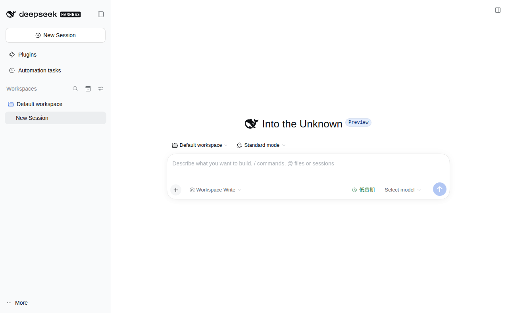
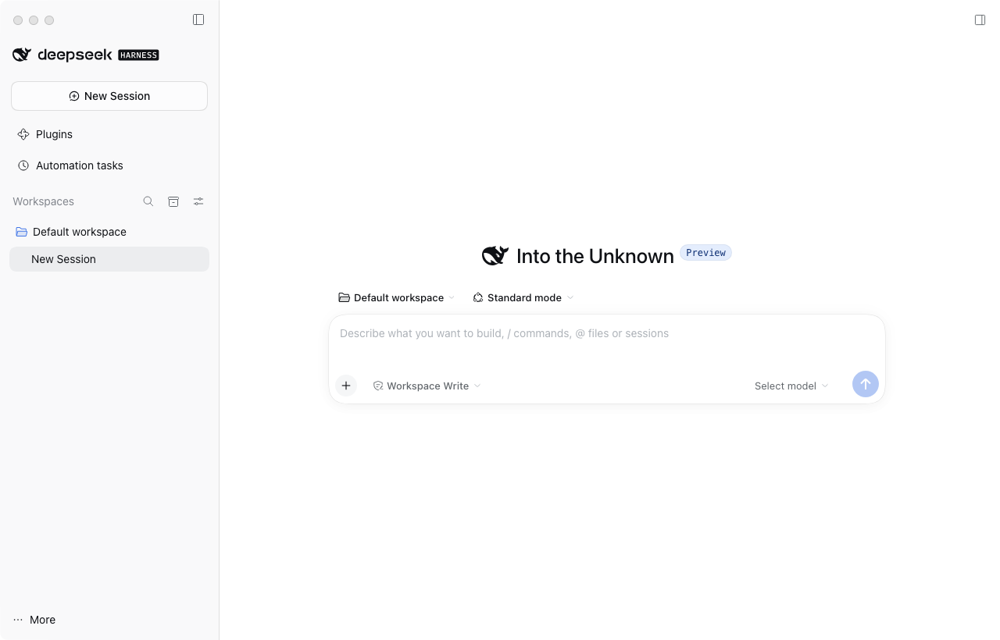

# Missher DeepSeek Harness Desktop

English | [中文](README.zh.md)

**[All plugins and project links](plugins/README.md)** · [Desktop downloads](#downloads) · [Published releases](https://github.com/Missher12/Missher-DeepseekHarness-Desktop/releases)

A desktop workspace for working with AI models, files, tools and optional plugins. This is the **Missher community build** of DeepSeek Harness. Download the app for your computer below; you do not need to build the source to use it.

The application does not include a model account or API credits. Configure your own provider after installation. Plugin source, application downloads and personal data are separate: downloading this repository never copies someone else’s chats, keys or learned experiences.

## Screenshots

| Ubuntu x64 | Intel Mac |
| --- | --- |
|  |  |

Real application windows from release **0.2.1-alpha.2.20261014.1**, captured with separate test profiles and no personal chats. These show the initial workspace; plugin interfaces depend on the plugins you install. Click an image to view it at full size.

<a id="downloads"></a>

## Download / 下载安装

Choose **Intel Mac** for a Mac with an Intel processor, and **Ubuntu x64** for a 64-bit Intel/AMD Ubuntu PC. “Intel” is the processor family; the old repository name used “Inter”. These packages do not target Apple Silicon natively or Linux ARM.

| Computer / 电脑 | Download / 下载 | Requirements |
| --- | --- | --- |
| **Intel Mac** | [DMG 安装包](https://github.com/Missher12/Missher-DeepseekHarness-Desktop/releases/download/desktop-v0.2.1-alpha.2.20261014.1/deepseek-harness-0.2.1-alpha.2.20261014.1-mac-x64-unsigned.dmg) · [Release notes / 版本说明](https://github.com/Missher12/Missher-DeepseekHarness-Desktop/releases/tag/desktop-v0.2.1-alpha.2.20261014.1) | macOS x64; community unsigned build |
| **Ubuntu x64** | [DEB 安装包（推荐）](https://github.com/Missher12/Missher-DeepseekHarness-Desktop/releases/download/desktop-v0.2.1-alpha.2.20261014.1/deepseek-harness-0.2.1-alpha.2.20261014.1-linux-x64-unsigned.deb) · [Release notes / 版本说明](https://github.com/Missher12/Missher-DeepseekHarness-Desktop/releases/tag/desktop-v0.2.1-alpha.2.20261014.1) | Ubuntu 24.04 x64 |
| **Ubuntu x64, portable** | [AppImage](https://github.com/Missher12/Missher-DeepseekHarness-Desktop/releases/download/desktop-v0.2.1-alpha.2.20261014.1/deepseek-harness-0.2.1-alpha.2.20261014.1-linux-x64-unsigned.AppImage) | Built; separate AppImage launch not qualified |

The current community release is **0.2.1-alpha.2.20261014.1**, published through the regular Release channel and based on official 0.2.1-alpha.2, with the Missher extensions for archived-session deletion, model-row settings and Context local.9. The [seven-plugin set and exact package list](https://github.com/Missher12/Missher-DeepseekHarness-Desktop/releases/tag/desktop-v0.2.1-alpha.2.20261014.1) preserves the versions from that Desktop release. For later plugin updates, use the “Latest release” links in the [plugin directory](plugins/README.md). The set excludes Media, independent Obsidian and the paused Computer Browser plugin.

The Ubuntu DEB has passed installation and desktop startup checks. The Intel Mac DMG has passed native packaging, integrity, isolated workspace and actual renderer checks. [Verification details](https://github.com/Missher12/Missher-DeepseekHarness-Desktop/releases/tag/desktop-v0.2.1-alpha.2.20261014.1) describe the exact scope; these checks do not qualify every model or plugin workflow. Desktop and plugin packages must each be installed on the target computer.

Each release includes SHA-256 checksums and its validation scope. [All releases](https://github.com/Missher12/Missher-DeepseekHarness-Desktop/releases) retain earlier packages. A source ZIP under **Code** is a source snapshot, not an installer. Linux x64 uses the published update feed; downloads and installation require separate user actions, with downgrades disabled. The installed DEB and a same-version update check were verified; cross-version automatic installation was not exercised. The unsigned Intel Mac package uses manual DMG installation.

### Install on Intel Mac

1. Download the DMG above and open it. Drag **DeepSeek Harness.app** into **Applications**.
2. When replacing an existing copy, quit it first. Keep a backup of its data and existing application until the new version works.
3. Open the app from Applications. If macOS blocks this unsigned community app, verify the release source and checksum, then use the system’s per-app approval in **System Settings → Privacy & Security**. Do not disable Gatekeeper globally.

The community Intel build retains its separate `~/Library/Application Support/DeepSeek Harness Intel` data directory. Replacing the app does not copy or reset the plugin profile, chats or credentials.

### Install on Ubuntu

Download the `.deb`, open a terminal in its directory, then run:

```bash
sudo apt install ./deepseek-harness-0.2.1-alpha.2.20261014.1-linux-x64-unsigned.deb
```

Launch **DeepSeek Harness** from the application menu. The DEB package was installed and its Electron window was launched on Ubuntu 24.04 under Xvfb. That proves startup, not every model or plugin workflow.

### First start

1. Choose a project folder as your workspace. If the system Documents directory is unavailable, select a folder manually.
2. Open model settings, add your provider, endpoint, API key and model name. Model support determines text/image input and reasoning levels.
3. Start a small conversation to verify your provider. API usage may be charged by that provider.
4. Extract the matching plugin ZIP and use **Plugins → Add plugin** for the `.tgz` files you need. Follow the plugin's installation guide to replace an existing version, and finish active tasks before restarting. Compare the installed and active versions with the selected release manifest. Desktop installers do not automatically install personal plugins.

## Plugins / 独立插件

Bookmark this repository as the common entry point. Each name below opens its own GitHub repository; the [complete directory](plugins/README.md) explains where to use it, which projects are private, and which work is paused. Follow the [installation guide](docs/cookbook/install-cordis-plugins.md) for DSH plugins; independent Obsidian installs in Obsidian.

| Plugin | What it does |
| --- | --- |
| [Context Manager](https://github.com/Missher12/Missher-DSH-Context-Manager) | Inspect and compact the current conversation context |
| [Usage Statistics](https://github.com/Missher12/Missher-DSH-Usage-Statistics) | Activity and usage across conversations |
| [Output Renderer](https://github.com/Missher12/Missher-DSH-Output-Renderer) | Four reading layouts, spacing and streaming effects |
| [Session Bridge](https://github.com/Missher12/Missher-DSH-Session-Bridge) | Session IDs, message delivery, temporary workspaces and permanent deletion of archived sessions |
| [Reasoning Effort](https://github.com/Missher12/Missher-DSH-Reasoning-Effort) | Reasoning slider and model capability settings |
| [Project Ops](https://github.com/Missher12/Missher-DSH-Project-Ops) | Project tasks, development plans in PLAN.md and delivery records in READY.md |
| [MSE Learning](https://github.com/Missher12/Missher-MSE-Learning) | Scoped learning from corrections and evaluated methods; product code only, without personal learning data |
| [Computer Browser](https://github.com/Missher12/Missher-DSH-Computer-Browser) | Browser and computer controls; development is paused, and current native workflows are not accepted |
| [Media (private)](https://github.com/Missher12/Missher-Media) | Chrome CDP collection and selected exports |
| [Independent Obsidian Memory](https://github.com/Missher12/Missher-Obsidian-Memory) | Notes, memory and review inside Obsidian; separate from the retired DSH Obsidian bundle |

Media alone remains in a private repository; independent Obsidian Memory is open source under MIT. Personal Vaults, notes and learning records remain private. All plugins are optional. See the [release and compatibility policy](plugins/README.md#release-and-version-compatibility) for support across Host versions.

## Common questions

**Why is an installed plugin missing?** Check the active application/profile, whether the plugin is enabled, and the load error. Restart or reload as requested by the host. Updating Git source alone does not update an installed application.

**Why is archive deletion missing?** Install Session Bridge from the matching plugin set and use this Missher Desktop build. The deletion action is available only for archived sessions when the Host exposes the deletion interface. An unmodified official Host may lack that interface.

**Does Git sync my chats?** No. The repositories contain product source and distributable files. Move private data separately with a backup; never put API keys, cookies, chat logs or learning databases into public Git.

**Can Mac, Windows and Ubuntu share changes?** Yes, the desktop source is shared. Native executables and installers must be built for each platform. A Mac DMG cannot run on Ubuntu.

**Where should I report a problem?** Use the affected plugin’s Issues for plugin behavior, and this repository’s Issues for installation or desktop startup. Include OS, app/plugin versions, steps and redacted errors.

<a id="run"></a>

<a id="run-from-source"></a>

## For developers

Use Node.js `^22.19.0 || >=24.0.0` and pnpm `11.7.0`. Build the host here and develop each plugin in its own repository; the [plugin development guide](docs/cookbook/build-cordis-plugins.md) explains SDK linkage.

```sh
git clone https://github.com/Missher12/Missher-DeepseekHarness-Desktop.git
cd Missher-DeepseekHarness-Desktop
pnpm install --frozen-lockfile
pnpm run build
pnpm dsh web
```

Use a separate data directory for development beside an existing installation. See [desktop packaging](apps/desktop/README.md), [installation](docs/cookbook/install-cordis-plugins.md), [architecture](docs/architecture.md), [safety](SAFETY.md) and [contributing](CONTRIBUTING.md).

## Project ownership and license

Built on [DeepSeek Harness](https://github.com/deepseek-ai/deepseek-harness) by [DeepSeek AI](https://deepseek.com) and the [Cordis](https://github.com/cordiverse/cordis) plugin architecture. Missher maintains this community distribution and independent extensions. Upstream authorship, history and licenses remain intact; this is not an official DeepSeek release.

[MIT](LICENSE); see [third-party notices](THIRD_PARTY_NOTICES.md), each plugin’s license, and [repository ownership](CORDIS.md).
