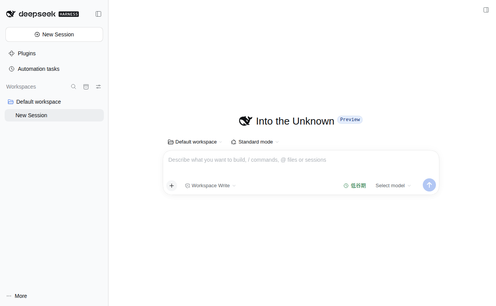
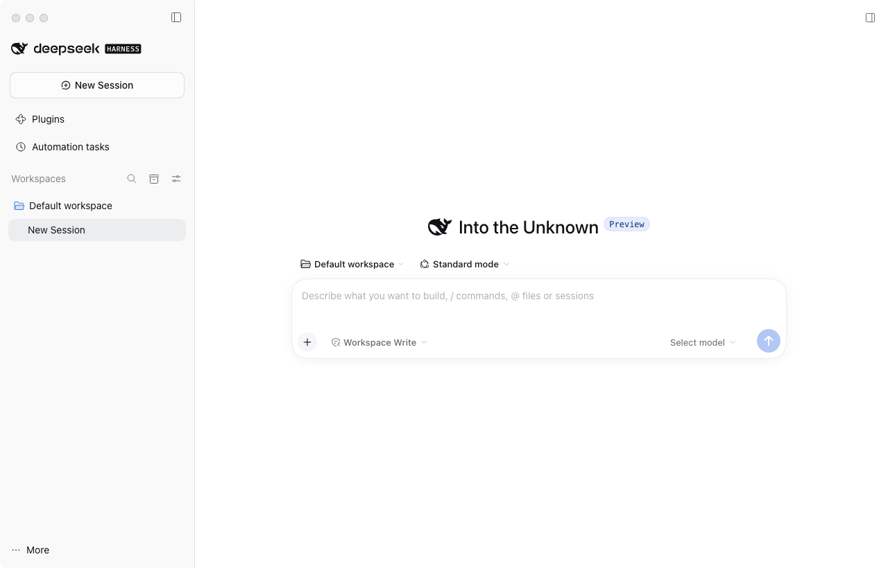

# Missher DeepSeek Harness Desktop

[English](README.md) | 中文

**[全部插件与项目总目录](plugins/README.zh.md)** · [桌面端下载](#downloads) · [已发布版本](https://github.com/Missher12/Missher-DeepseekHarness-Desktop/releases)

这是一个可以连接 AI 模型、操作项目文件、调用工具并安装扩展的桌面应用。本仓库维护 **Missher 社区版 DeepSeek Harness**。普通用户下载下面对应系统的安装包即可，不需要学习编译源码。

应用不附带模型账号或 API 额度，安装后需配置自己的模型服务。桌面安装包、插件源码和个人数据分别管理；下载本仓库不会带走他人的聊天、密钥或学习记录。

## 界面预览

| Ubuntu x64 | Intel Mac |
| --- | --- |
|  |  |

图片来自 **0.2.1-alpha.2.20261014.1** 的真实应用窗口，使用独立测试配置，不含个人聊天。这里展示初始工作区；插件界面取决于你安装的插件。点击图片可查看原图。

<a id="downloads"></a>

## 下载安装

Intel 芯片的 Mac 选择 **Intel Mac**；使用 Intel/AMD 64 位处理器的 Ubuntu 电脑选择 **Ubuntu x64**。Intel 是处理器名称，旧仓库曾写成 Inter。本页安装包不包含 Apple Silicon 原生版或 Linux ARM 版。

| 电脑 | 下载 | 适用范围 |
| --- | --- | --- |
| **Intel Mac** | [DMG 安装包](https://github.com/Missher12/Missher-DeepseekHarness-Desktop/releases/download/desktop-v0.2.1-alpha.2.20261014.1/deepseek-harness-0.2.1-alpha.2.20261014.1-mac-x64-unsigned.dmg) · [版本说明](https://github.com/Missher12/Missher-DeepseekHarness-Desktop/releases/tag/desktop-v0.2.1-alpha.2.20261014.1) | Intel Mac；社区未公证包 |
| **Ubuntu x64** | [DEB 安装包（推荐）](https://github.com/Missher12/Missher-DeepseekHarness-Desktop/releases/download/desktop-v0.2.1-alpha.2.20261014.1/deepseek-harness-0.2.1-alpha.2.20261014.1-linux-x64-unsigned.deb) · [版本说明](https://github.com/Missher12/Missher-DeepseekHarness-Desktop/releases/tag/desktop-v0.2.1-alpha.2.20261014.1) | Ubuntu 24.04 x64 |
| **Ubuntu x64 便携格式** | [AppImage](https://github.com/Missher12/Missher-DeepseekHarness-Desktop/releases/download/desktop-v0.2.1-alpha.2.20261014.1/deepseek-harness-0.2.1-alpha.2.20261014.1-linux-x64-unsigned.AppImage) | 已构建；未单独完成 AppImage 启动验收 |

当前桌面安装包见 [Releases](https://github.com/Missher12/Missher-DeepseekHarness-Desktop/releases)。上表和[七插件合集](https://github.com/Missher12/Missher-DeepseekHarness-Desktop/releases/tag/desktop-v0.2.1-alpha.2.20261014.1)保留 **0.2.1-alpha.2.20261014.1** 的历史下载；当前插件更新使用[插件目录](plugins/README.zh.md)中的独立项目入口。

上述历史版本的 Ubuntu DEB 已通过安装及桌面启动检查；Intel Mac DMG 已通过原生打包、完整性、隔离工作区和实际界面检查。[验证说明](https://github.com/Missher12/Missher-DeepseekHarness-Desktop/releases/tag/desktop-v0.2.1-alpha.2.20261014.1)列出准确范围，这些检查不代表每种模型或插件流程都已验收。桌面安装包和插件包需要分别安装到目标电脑。

每个发布页提供 SHA-256 校验文件和验证范围，[全部发布记录](https://github.com/Missher12/Missher-DeepseekHarness-Desktop/releases)保留早期安装包。GitHub 的 **Code → Download ZIP** 下载的是源码，不能代替安装包。Linux x64 使用已发布的更新源，下载和安装分别由用户触发，禁止降级；本机 DEB 安装与同版本检查已验证，跨版本自动安装尚未实测。Intel Mac 未签名版使用 DMG 手动安装。

### Intel Mac 安装

1. 下载上面的 DMG 并打开，把 **DeepSeek Harness.app** 拖进 **Applications（应用程序）**。
2. 替换已有应用前先正常退出，保留数据和旧应用备份，确认新版正常后再处理备份。
3. 从应用程序中打开。如果 macOS 拦截此社区未公证包，先核对来源与校验值，再在 **系统设置 → 隐私与安全性** 中对该应用单独允许打开；无需关闭系统整体安全检查。

社区 Intel 版沿用独立的 `~/Library/Application Support/DeepSeek Harness Intel` 数据目录。替换应用本体不会复制或重置其中的插件配置、会话与凭据。

### Ubuntu 安装

下载 `.deb` 后，在下载文件所在目录打开终端，运行：

```bash
sudo apt install ./deepseek-harness-0.2.1-alpha.2.20261014.1-linux-x64-unsigned.deb
```

安装后在应用菜单中打开 **DeepSeek Harness**。DEB 已在 Ubuntu 24.04 完成安装及 Xvfb 下的 Electron 窗口启动验证；这证明应用能启动，不代表每种模型或插件流程都已验收。

### 第一次打开

1. 选择一个项目文件夹作为工作区。如果系统没有可用的“文档”目录，手动选择文件夹即可。
2. 打开模型设置，填入自己的服务商、地址、API Key 和模型名称；文本、图片与思考档位取决于模型实际能力。
3. 发一条简单消息检查服务是否可用，模型调用费用由所使用的服务商计算。
4. 从[插件目录](plugins/README.zh.md)选择所需插件，按对应项目的安装指南更新。等活动任务结束后再按宿主提示重新加载或重启；核对当前配置组中的已安装与已加载版本。桌面安装包不会自动安装个人插件。

## 独立插件：按需要选择

[插件目录](plugins/README.zh.md)集中日常插件和平台专用扩展，安装和版本要求由各项目自己的说明维护。

| 入口 | 用途 |
| --- | --- |
| [Memory Native](https://github.com/Missher12/Missher-DSH-Memory-Native) | 当前记忆系统 |
| [Media@Missher Ego](https://github.com/Missher12/Media-Missher-Ego) | 当前媒体采集入口，私有 |
| [DSH 插件目录](plugins/README.zh.md) | 上下文、统计、输出外观、会话桥接、思考强度、Project Ops、Superagent、Focus 与 MSE |

各插件分别发布和安装。私有项目需要仓库访问权限；个人配置、会话、记忆和学习数据继续由各自运行环境保管。

需要在一个 Agent 会话中下载全部插件源码时，使用[12 个插件清单](plugins/catalog.json)和[批量下载说明](plugins/README.zh.md#download-all-plugins-with-an-agent)。

## 常见问题

**为什么安装后找不到插件？** 检查当前应用及配置组是否正确、插件是否启用和加载错误；按宿主提示重启或重新加载。只更新 Git 源码不会自动更新已安装的应用。

**为什么没有归档删除？** 安装配套合集中的会话桥接插件，并使用本次 Missher 桌面版。入口仅在已归档会话且宿主提供删除接口时显示；纯官方宿主可能没有该接口。

**另一台电脑拉取 Git，会同步聊天吗？** 不会。仓库提供产品源码与可分发文件，私人数据需要另行备份迁移；不要把 API Key、Cookie、聊天记录或学习数据库放入公开 Git。

**Mac、Windows 和 Ubuntu 能共用修改吗？** 可以共用桌面源码；原生程序和安装包必须分别构建。Mac 的 DMG 不能直接在 Ubuntu 运行。

**问题应该反馈到哪里？** 插件功能问题交给对应插件仓库的 Issues；安装与桌面启动问题交给本仓库。请提供系统、应用/插件版本、复现步骤及脱敏错误。

<a id="run"></a>

<a id="run-from-source"></a>

## 给开发者

使用 Node.js `^22.19.0 || >=24.0.0` 与 pnpm `11.7.0`。宿主在本仓库构建，插件在各自独立仓库开发；SDK 接入见[插件开发指南](docs/cookbook/build-cordis-plugins.zh.md)。

```sh
git clone https://github.com/Missher12/Missher-DeepseekHarness-Desktop.git
cd Missher-DeepseekHarness-Desktop
pnpm install --frozen-lockfile
pnpm run build
pnpm dsh web
```

与已有安装同时开发时使用独立数据目录。进一步阅读[桌面打包](apps/desktop/README.zh.md)、[插件安装](docs/cookbook/install-cordis-plugins.zh.md)、[架构](docs/architecture.zh.md)、[安全说明](SAFETY.zh.md)与[贡献指南](CONTRIBUTING.zh.md)。

## 项目来源与许可

本项目基于 [DeepSeek Harness](https://github.com/deepseek-ai/deepseek-harness)，由 [DeepSeek AI](https://deepseek.com) 开发，并沿用 [Cordis](https://github.com/cordiverse/cordis) 插件架构。Missher 维护这里的社区分发与独立扩展，保留上游作者、历史和许可；本仓库不是 DeepSeek 官方发行渠道。

宿主采用 [MIT](LICENSE)，同时遵循[第三方声明](THIRD_PARTY_NOTICES.md)及各插件自己的许可证；仓库分工见 [CORDIS.md](CORDIS.md)。
