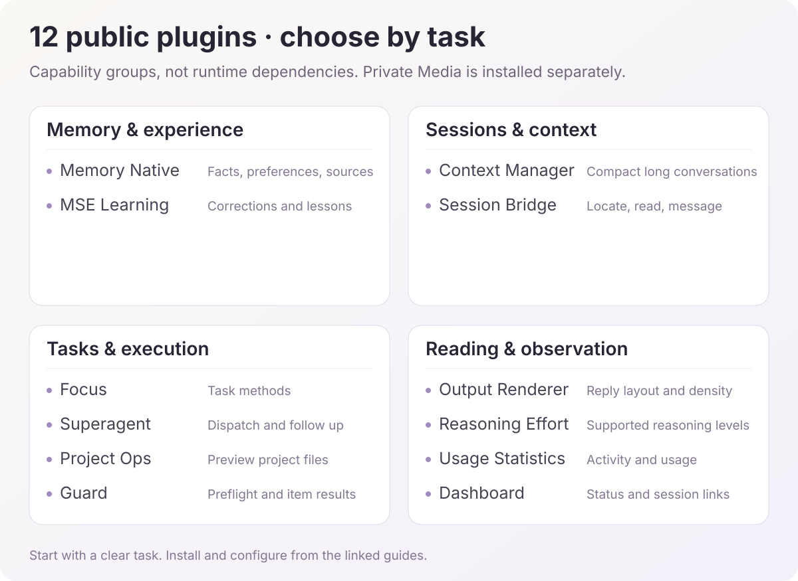

# DSH plugin directory

English | [中文](README.zh.md)

[Repository home](../README.md) · [Installation](../docs/cookbook/install-cordis-plugins.md) · [Development](../docs/cookbook/build-cordis-plugins.md)


There are **13 independent plugins: 12 public and 1 private**. The recommended set includes all 12 public plugins; private Media@Missher Ego is installed separately. Use Memory Native for the current memory system.

<a id="install-recommended-plugins"></a>

## Install the recommended set in one agent chat

Give an agent the main repository URL and the prompt below. The [public install manifest](install-set.json) lists published Release `.tgz` packages for all 12 public plugins. Existing plugin instances, settings and data are preserved.

```text
Read https://github.com/Missher12/Missher-DeepseekHarness-Desktop/blob/main/plugins/install-set.json.
Install or update all 12 public plugins in my current DSH installation in this chat.
Check each repository for newer published Releases with a matching `.tgz`; prefer a newer Host-compatible release,
otherwise use the verified package listed. Check package identities and versions; keep Memory on its current native release line.
Prefer the Host's native plugin manager and update existing instances while preserving settings, sessions, memory and learning data.
Keep the same or newer installed versions without reinstalling or downgrading. Exclude private Media@Missher Ego.
Load updates as the Host requires without force-quitting an active application.
Report each installed version, enabled and loaded state, and any failure, missing capability or pending restart.
```

The table below describes each plugin. Guard supports Windows and macOS; its runtime is skipped on Linux hosts.

<!-- plugin-visual-guide -->
## Choose plugins visually



These groups describe capabilities, not runtime dependencies. Private Media@Missher Ego is installed separately. Start with the capabilities your current task needs, then adjust other settings when useful.

| Goal | Start here | Inspect next |
| --- | --- | --- |
| Continue a long task and retain context across chats | Context Manager for the current conversation; Memory Native for lasting facts and sources | Read the summary or source text and verify scope and current facts |
| Dispatch a bounded task to a separate session | Superagent selects the real workspace; Focus supplies task methods as needed | Inspect activity and results, then locate deliverables with Project Ops |
| Process files and verify execution | Guard checks the executor, directory and explicit input list | Read per-item results, including failures and unresolved items |
| Improve reading and understand usage | Output Renderer adjusts layout; Reasoning Effort selects declared model levels | Usage Statistics shows activity; Dashboard links to sessions needing attention |

For example, ask Superagent to analyze a project's entry points with source references and no file changes. Review the real session and use Project Ops to open the resulting files. A workbench state or chart color alone does not establish task completion.

Each plugin repository includes an illustrated usage guide with steps, examples, result checks and settings advice. Flow diagrams and scene illustrations are labeled; existing screenshots retain their version context.
<!-- /plugin-visual-guide -->

<a id="public-plugins"></a>

## Recommended plugins (12 public)

| Plugin | Purpose | Repository |
| --- | --- | --- |
| [Memory Native](https://github.com/Missher12/Missher-DSH-Memory-Native) | Cross-session memory, search and source-linked recall | Public |
| [Context Manager](https://github.com/Missher12/Missher-DSH-Context-Manager) | Context, usage, pre-request and idle compaction | Public |
| [Usage Statistics](https://github.com/Missher12/Missher-DSH-Usage-Statistics) | Cross-session usage, activity and rankings | Public |
| [Output Renderer](https://github.com/Missher12/Missher-DSH-Output-Renderer) | Reading layouts, reasoning and tool details, typography and streaming effects | Public |
| [Session Bridge](https://github.com/Missher12/Missher-DSH-Session-Bridge) | Session IDs, cross-session messages, scratch workspaces and archived-session management | Public |
| [Reasoning Effort](https://github.com/Missher12/Missher-DSH-Reasoning-Effort) | Supported reasoning levels and inline model controls | Public |
| [Project Ops](https://github.com/Missher12/Missher-DSH-Project-Ops) | Project tasks and files, artifact previews and file locations | Public |
| [Superagent](https://github.com/Missher12/Missher-DSH-Superagent) | Dispatch project tasks, inspect progress and follow up | Public |
| [Focus](https://github.com/Missher12/Missher-DSH-Focus) | Research, writing, data, files and app tasks, with dedicated development workflows | Public |
| [Dashboard](https://github.com/Missher12/Missher-DSH-Dashboard) | Session status, Token trends, goals and Superagent overview | Public |
| [MSE Learning](https://github.com/Missher12/Missher-MSE-Learning) | Standing corrections, failure lessons and learning consolidation | Public |
| [Guard](https://github.com/Missher12/Guard) | Windows/macOS shell checks, reliable file batches and Office document operations | Public; Windows and macOS |

## Media@Missher

[Media-Missher-Ego](https://github.com/Missher12/Media-Missher-Ego) is the current media entry and remains private. It uses ego lite for Bilibili, Xiaohongshu, Douyin, Weibo and X, with incremental consolidation, resumable runs, historical comparisons and local exports. Its delivery notes own DSH integration and installation instructions.

## Community directory

[Plugin Catalog](https://github.com/Missher12/Missher-DSH-Plugin-Catalog) is a community-directory collaboration copy for discovering and submitting plugin entries. The projects above are the current Missher entries.

<a id="current-source-snapshots"></a>
<a id="release-and-version-compatibility"></a>

## Versions and installation

<a id="download-all-plugins-with-an-agent"></a>

### Download source repositories only

The [machine-readable catalog](catalog.json) lists 13 independent Missher plugins, including 12 public repositories and 1 private repository. The desktop host and community directory are separate projects. Guard supports Windows and macOS; Linux and Linux-hosted WSL are skipped. Follow its Host and Node requirements.

Give an agent this repository URL and ask: “Read `plugins/catalog.json`. Clone every listed plugin into a new directory using its `sourceRef`, and report the downloaded branch and commit. Keep existing installations, settings and data. List any repository that cannot be accessed; do not report a partial download as complete.” The agent needs Git; Media-Missher-Ego additionally requires repository access.

This prompt downloads source only. Use the [recommended install entry](#install-recommended-plugins) above to install the full set. For an installable package, follow the corresponding project's build or Release instructions; a newer development branch does not imply a matching Release asset exists. The catalog names branches rather than fixed versions, so read each downloaded `package.json` for its actual version.

Choose versions from each project’s release records and installation guide. Development branches, released packages and the loaded version in the current application are separate records; source updates do not replace plugins in daily DSH automatically. Each project documents minimum Host capabilities, verified targets and limitations.

Only Media-Missher-Ego requires an authorized GitHub account. Settings, sessions, memory, learning libraries and collected data remain in their respective runtime environments.

The [older plugin-set manifest](../distribution/plugin-set.json) and [early repository record](../cordis-repositories.json) retain versions and checksums from their original releases; use the projects above for current plugin choices.
